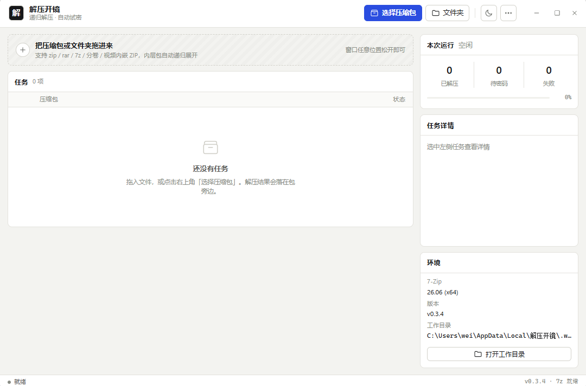
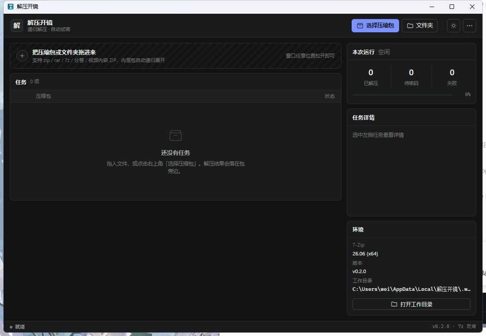

# 解压开镜 · Rust 版

把互联网上那些乱七八糟的多层压缩包，一次性解干净。

这是「解压开镜」（Python + PySide6 版，44 MB）的 Rust 重写分支，
目标是把体积从 44 MB 压到 3–4 MB，同时保留全部行为。

## 当前进度

| 阶段 | 内容 | 状态 |
| --- | --- | --- |
| P0 | 工具链、workspace、体积基线 | ✅ |
| P1 | 无密码引擎：嗅探 → 探测 → 落点 → 解压 → BFS 内层递归 | ✅ |
| P2 | 密码系统：候选派生、SQLite 密码库、ZipCrypto 预筛、WinZip-AES 进程内解密 | ✅ |
| P2.5 | 云端密码库查询（MD5 查询 + HTTP 客户端） | ⬜ 按你的要求延后 |
| P3 | 乱码文件名、视频内嵌 ZIP、任务持久化、暂存清理 | ✅ |
| P3.5 | 分卷归并（含缺首卷告警）、vault 加密导出/导入（与 Python 版格式互通） | ✅ |
| P4 | Tauri GUI（主窗/设置/密码库/清理/导出备份） | ✅ |
| P5 | 右键菜单（解压到当前目录 / 解压到指定目录）、便携版打包 | ✅ |
| UI | 无边框自绘标题栏（最小化/最大化/关闭内置）、Swiss 工具风、浅/深主题、任务列表 + 详情栏 | ✅ v0.3.4 |
| 图标 | 黄色闪电贯穿翻开的书，书页扇形翻动 | ✅ v0.3.5 |
| 启动 | 窗口先隐藏，主界面/小窗排好后再显示，右键启动不再闪主 UI | ✅ v0.3.6 |
| 标题栏 | 品牌图标换成新应用图标；无边框窗口全标题栏可拖动 | ✅ v0.3.7 |
| 内嵌包 | 支持 ZIP64 尾部目录，19 GB 视频里藏的包也能正确定位；单条内层包直接跳过视频壳解出 | ✅ v0.3.9 |
| 密码提速 | 非 ZIP 加密包先并行 `7z t` 单条目预筛；错误密码不再每个都整包解一遍 | ✅ v0.3.10 |
| 7z 快筛 | 纯 Rust 直接读第一个加密条目验证密码，不启动 7z；正式解压仍交给 7z | ✅ v0.4.0 |

### 界面预览





完整方案与模块对应关系见 [docs/重写方案.md](docs/重写方案.md)。

## 已经能做什么

- **magic 嗅探**：扩展名对不上也认得出（`.dat`、无扩展名）；视频/图片等明确非压缩类型直接短路，不碰磁盘
- **分卷归并**：`a.part01.rar` 与 `a.7z.001` 两种流派，只解首卷
- **探测**：`7z l -slt` 解析，分卷包从 `Split` 里挑出真实格式；压缩比与总大小护栏
- **递归解压**：BFS 逐层展开，内层包保留包名成一级目录，解完自动删掉中间包体
- **落点规则**：默认解到 `<压缩包所在目录>/<包名>/`，同名自动 `~2` 避让
- **自动密码**：文件名提示（`[密码:xxx]`）→ 来源域名派生 → 密码库（同来源优先）→ 内置字典
- **ZipCrypto 预筛**：12 字节头算末字节，明显不匹配的候选直接跳过
- **WinZip-AES 进程内解密**：2 字节校验值是权威判据，通过就自己解，绕开 7z 对非 ASCII 密码的坏路径
- **RAR 等非 7z 并行预筛**：先对第一个加密条目做 `7z t`，多线程同时排除错误密码；
  命中后才整包解，避免每个候选都走一遍全量解压
- **7z 纯 Rust 快筛**：用 `sevenz-rust2` 直接打开 7z、只读第一个加密条目验证密码，
  不启动 7z 进程；密码命中后才交给 7z 正式解压。遇到不支持的 7z 结构自动回退 `7z t`
- **密码库自学习**：试通的密码自动入库并累计命中，SQLite 与 Python 版同表，可直接复用旧库
- **乱码文件名修复**：先对整包判一次编码（GBK / GB18030 / Shift-JIS / EUC-JP / UTF-8），
  再按它统一解码；判不准就逐名反推，两道闸门保证「宁可漏修，绝不把好名字改坏」
- **排查用**：`jieya encoding <包>` 可以看到判定结果和各候选打分，排查乱码时用
- **视频内嵌 ZIP**：`.mp4` 里藏着的 ZIP 会按中央目录反推真实边界；
  只有一条内层压缩包时（例如 `bambi.7z`）直接跳过视频壳解出内层包，
  不再复制整段视频+ZIP；多条目或加密包才回退到整段临时副本。
  支持普通 EOCD 与 ZIP64（大文件/大偏移），普通视频没有内嵌包时直接提示
  「这不是压缩包」，不会让 7z 去硬扫 19 GB
- **任务历史**：每次解压都写进 `jieya.db` 的 `tasks` 表（与原版同结构、同状态机），
  `jieya tasks` 可查
- **暂存区清理**：`jieya cleanup scan` 盘点工作目录与各盘 `.jieya_staging` 的残留，
  `prune` 只删「产物已另有一份」的项，其余一律保留并给出原因
- **密码库备份**：`jieya vault export` / `import` 用 scrypt + AES-256-CTR + HMAC 的
  `.vault` 容器，**与 Python 版同格式双向互通**；GUI 密码库面板也有导出/导入按钮
- **右键菜单**：GUI 设置里一键添加，只写 `HKCU`，不需要管理员。菜单只注册在
  **文件**上，文件夹和目录空白处不会出现；旧版留在空目录的键会在启动时自动清掉。
  菜单是二级结构：
  「解压到当前目录」直接解到包旁边；「解压到指定目录…」先弹目录选择框，
  顶层产物落到 `<所选目录>/<包名>/`，内层包继续留在这个目录里。右键启动走
  600×340 的小窗进度条：显示格式/体积、进度百分比和阶段提示；加密包会直接
  给出密码输入框，输入正确后接着解；正常解完 1.5 秒后自动关闭，失败或待密码
  时留在窗口里显示原因
- **无边框标题栏**：主界面和小窗都用自绘的最小化/最大化/关闭按钮，拖动标题栏移动窗口
- **输出即最终位置**：普通压缩包不经过任何中转目录，直接写目标目录。只有两种情况
  需要临时文件，且用完就删：① 视频内嵌 ZIP 要按字节边界切出来（临时副本放在目标盘，
  不会堆在 C 盘）；② 分卷被外层包解到不同目录时要先归并（优先硬链接）

```powershell
# 解一个包（递归展开内层，自动试密码）
.\target\release\jieya.exe extract D:\下载\某个包.zip

# 只看是什么、多大、几个文件
.\target\release\jieya.exe detect D:\下载\某个包.zip

# 密码库
.\target\release\jieya.exe vault stats
.\target\release\jieya.exe vault add unknown999
.\target\release\jieya.exe vault export D:\备份\passwords.vault --password 你的口令
.\target\release\jieya.exe vault import D:\备份\passwords.vault --password 你的口令
```

## 构建

```powershell
# 需要：Rust stable + MSVC Build Tools（链接器）
cargo build --release
# 产物：target\release\jieya.exe（CLI，1.77 MB）
#       target\release\jieya-app.exe（GUI，4.13 MB，依赖系统 WebView2）
```

GUI 前端是纯静态 HTML/CSS/JS（`crates/jieya-app/ui`），不需要 npm 工程。

打包便携版：

```powershell
pwsh tools\build-release.ps1 -Version 0.4.0
# 产物：dist\解压开镜-0.4.0-win64.zip
```

依赖外部 `7-Zip`（`7z.exe`），定位顺序：`--sevenzip` > `SEVENZIP_PATH` > 常见安装路径 > `PATH`。

## 目录

```
crates/jieya-core   引擎（零 GUI 依赖，可独立测试）
crates/jieya-cli    命令行入口
crates/jieya-app    Tauri v2 外壳（Rust 命令 + 静态前端）
docs/               方案与设计
```
